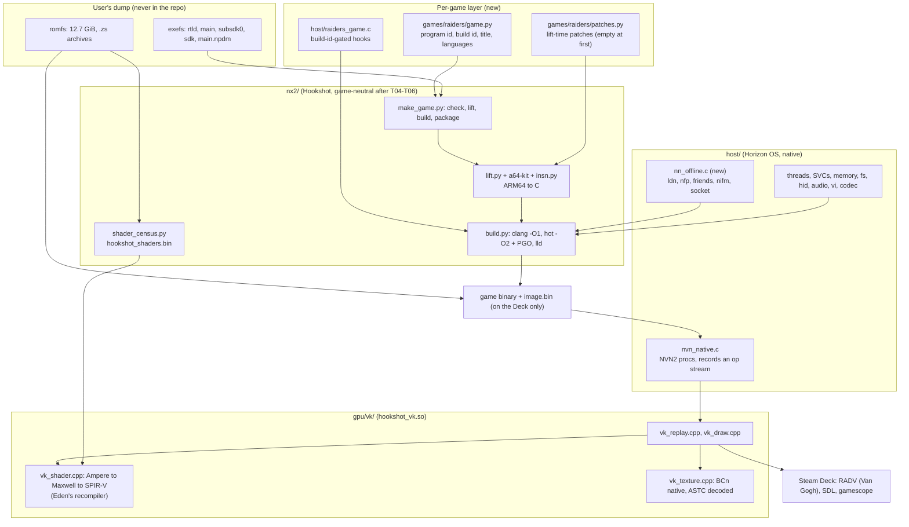

# 00 · Overview

Planning date: 2026-11-10. Reference pipeline: Hookshot `88b554e` (2026-11-10). Evidence tags used throughout
these documents: **[verified]** (a file path, URL or an observation of the dump is cited), **[inferred]**,
**[unknown]** (becomes a research step in a task).

## Goal

Run the user's own dump of *Splatoon Raiders* (Nintendo Switch 2, program `0400380020056000`, base game,
main build `abb30e2f…`) natively on a Steam Deck as a static recompilation: the game's AArch64 code translated
to C and compiled for x86-64, Horizon OS reimplemented, NVN2 replayed on Vulkan (RADV). Single player, offline,
personal use. No game data, keys or generated output is ever committed.

## Strategy: fork and adapt Hookshot

| Option | For | Against |
|---|---|---|
| **A. Fork Hookshot, keep its paths, add a per-game layer** (recommended) | The whole pipeline already accepts this binary: lift 100% (verified), shader census works after a one-line fix (verified), same engine family, same service set. Upstream fixes land daily and merge when paths match (Hookshot does the same with mkw-recomp, `docs/design.md` §2). | GPL-3.0-or-later. Shared files carry Ocarina-specific code that has to be gated. Upstream churn. |
| B. New repo that vendors Hookshot (subtree) | Cleaner ownership. | Every sync is manual; generic fixes are harder to send back; no technical gain. |
| C. Build on Recompia's nxrecomp/nxrt | Cleaner game boundary, C++ runtime. | Windows-native (Deck runs it through Proton), different engine target (Koei Tecmo title), no evidence it handles agl/gsys titles, mesh/task path differs. Would repeat work Hookshot has done for this engine. |
| D. Reimplement | None for a one-person, few-hours-a-week project. | Years of work. |

**Recommendation: A.** The user chose "fork, upstream generic fixes". Raiders-specific code goes in new files
(`games/raiders/`, `host/raiders_*.c`, `nx2/raiders_*.py`); edits to shared files are limited to replacing a
hardcoded Ocarina constant with a lookup in the per-game layer, written so the same change can go upstream.

## Architecture

Development happens on the Mac (source, lifting, analysis, game-free checks). Compiling, linking and every run
of the game happen on the Deck, which holds its own copy of the dump (`03-architecture.md`, `04-steam-deck.md`).

## Feasibility verdict: GO, with two gates

The static evidence is as good as it can be before a first boot:

- Lifter: 258,115 functions, 100.0000% of 18.4 M instructions translated, no unresolved indirect branch
  **[verified: `work/lift_coverage.log`]**.
- Same platform generation as the pipeline's reference game Mario Kart World (SDK 21.4.x) and the same engine
  family as Hookshot's game **[verified: `spikes/strings_probe.py`]**.
- Standalone hook/stub counts are in the same range as Hookshot's own game (528/279 against 485/243)
  **[verified: `spikes/standalone_summary.py`, `refs/Hookshot/docs/design.md` §9]**.
- Shaders: the material, agl, gsys and particle archives are vertex+fragment or compute only; no task shaders
  **[verified: `spikes/shader_stage_kinds.py`]**. Textures are 96% BCn, native on the Deck
  **[verified: `spikes/bntx_formats.py`]**. Movies are VP9 WebM, a path Hookshot decodes
  **[verified: `refs/Hookshot/host/nn_video.c:734`]**.

What static analysis cannot tell is whether the game boots, renders correctly and runs fast enough on a Deck.
Two go/no-go gates are therefore built into the roadmap:

- **Gate 1 (end of M4):** a title-screen screenshot on the Deck. If the boot needs more than the planned
  sessions because of problems outside the per-game layer, stop and re-plan.
- **Gate 2 (end of M5, measured in M7):** in-game frame rate and memory on the Deck. Hookshot's own game is
  CPU-bound on desktop CPUs; a Deck at 30 fps is the realistic target, and anything below a stable 30 fps in
  normal play after M7 is a no-go for "playable".

## Risks, ranked by likelihood × impact

| # | Risk | L | I | Mitigation |
|---|---|---|---|---|
| 1 | **Deck CPU performance.** Hookshot's design notes record 30-36 fps CPU-bound on a 6-core desktop CPU before tuning (`docs/design.md` §9-§10); the Deck has 4 slower cores shared with the replay thread **[inferred]**. | High | High | Measure at M5, not M7 (T17 logs fps). Hot list and PGO made on the Deck (T22). Thread-count tuning (`HOS_CORES`, `HOS_VCORES`, `HOS_RESERVE_CORE`). Accept a 30 fps cap. |
| 2 | **Gameplay-critical GPU-to-CPU read-back.** Splatoon-series games test ink coverage on the CPU from data the GPU drew **[inferred, from the series' known design]**. Hookshot copies GPU-written pools back to guest memory (`RX_VK_NO_WRITEBACK`, `RX_VK_WB_DIFF`), but lag or missing formats would break movement in ink, not just the picture. | Medium | High | T17 has an explicit ink-behaviour check. Research step: find the read-back path in the trace (T09). |
| 3 | **Memory on 16 GB shared.** A Hookshot run uses about 10 GB RAM on desktop plus VRAM. | Medium | High | T20: integrated-GPU texture cap (already 2560 MB), mirrors off, `RX_VK_TEX_MAX_DIM`, measure RSS + GPU memory; Raiders' romfs is half the size of Hookshot's game. |
| 4 | **RADV/AMD stability.** Open AMD issues upstream (#708, #614, #604, #528); a Deck GPU hang in a task shader (#817). Raiders has no task shaders statically, so that exact hang is unlikely, but others may exist. | Medium | High | T23 soak test with `journalctl -k`; `RX_VK_SKIP_CODE`, `RX_VK_MESH_NOCULL`, `RX_VK_VALIDATION` as tools. |
| 5 | **Shader translation gaps.** Geometry stages are dropped by `gpu/vk/vk_shader.cpp:2087`; 160 unique Raiders programs have one. Unknown lowering failure rate for Raiders' 26,960 stages. | Medium | Medium | T12 translates every stage offline on the Deck before the first frame is attempted; T14 adds geometry support only if a runtime log shows such programs are drawn. |
| 6 | **NVN2 or service calls no Hookshot game has made.** 325 NVN names not implemented by name; 279 stubbed imports. | High | Low-Medium | Expected work, sized into T09-T11. Unimplemented procs log their first call (`host/PROVENANCE.md`). |
| 7 | **Boot depends on online services.** NPLN, Pia and account-token calls are linked in; the title flow may wait on them. | Medium | Medium | Hookshot already answers these offline for its game (`docs/design.md` §9 "Offline answers"); T10 extends to `nn::ldn`, `nn::nfp`, `nn::friends`. |
| 8 | **Upstream churn.** Hookshot merged PR #1447 on the planning day; shared-file edits will conflict. | High | Low | New-files rule, weekly `git merge upstream/main`, generic fixes upstreamed (T25). |
| 9 | **Slow test loop.** The game cannot run on the Mac; every runtime check needs the Deck; a few hours a week. | High | Medium | T03 sets up SSH-driven build/run/fetch scripts so an Opus session on the Mac can run acceptance commands on the Deck. |
| 10 | **Version drift.** A later game update changes the build id. | Low | Low | One pin in `games/raiders/game.py`; address-based hooks are gated on the build id. |

## How to read the rest

| File | What |
|---|---|
| `01-research-findings.md` | Evidence from the dump, Hookshot, Recompia and other prior art, with licences. |
| `02-gap-analysis.md` | Per Hookshot subsystem: unchanged, generalise, or new work. The core document. |
| `03-architecture.md` | Target repo layout, per-game layer, build flow, upstream sync. |
| `04-steam-deck.md` | Deck GPU, memory, shader caching, display, controls, packaging, build host. |
| `05-roadmap.md` | Milestones with exit criteria and the task order. |
| `06-handoff-guide.md` | How to drive Opus sessions; prompt template; conventions; blocker reports. |
| `tasks/T01…T25` | One implementation task per file. |
