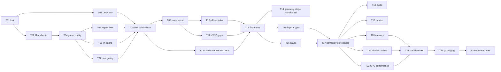

# 05 · Roadmap

Each milestone has one testable exit criterion. Tasks are sized for one Opus session each; a session that
finds more than it can finish writes a blocker report (`06-handoff-guide.md`) instead of stretching.
At a few hours a week, expect one or two tasks a week: 25 tasks is roughly four to six months, with wide
error bars on M4, M5 and M7 **[inferred]**.

The original suggested M0 (reproduce a Hookshot build of its own game) is replaced by a toolchain-only M0,
because the user does not have that game.

## Order and dependencies

De-risking is front-loaded: T12 (do the shaders translate on RADV at all?) and T09 (what does the game call
that the runtime lacks?) run as soon as a binary exists, before any effort goes into the picture. Frame rate
and memory are first measured in T13 and T17, not left to M7.

## Milestones

### M0 · Toolchain proven without a game
- **Tasks:** T01, T02, T03.
- **Exit:** on the Mac, `python -I -B tests/run_all.py` finishes with every failure explained in
  `docs/plans/reports/mac-test-baseline.md`. On the Deck, `scripts/deck/setup.sh` ends by building
  `hookshot_vk.so` with `RX_VK_ONLY=1` and prints a RADV driver line that includes `VK_EXT_mesh_shader`.
- **Risk retired:** the build host. If the Deck cannot build the renderer, stop and choose another host
  before touching game code.

### M1 · Ingest and version-check the Raiders dump
- **Tasks:** T04, T05.
- **Exit:** `python -I nx2/make_game.py --check --exefs <dump>/exefs` prints
  `@@check ok …` for build `abb30e2f`, and `@@check bad …` for a folder whose `main` differs;
  `python -I nx2/shader_census.py <romfs> --out work/raiders_shaders.bin` reports 22,042 programs.

### M2 · Lift, link, reach `nnMain`
- **Tasks:** T06, T07, T08.
- **Exit:** on the Deck, `work/sa/build/hookshot` exists and a `HOS_TRACE=1` run logs the boot sequence
  through `nnMain` and reaches `nvnBootstrapLoader` (Hookshot's stage S2, `docs/design.md` §6), or stops at a
  named unimplemented call recorded in `docs/plans/reports/M2-boot.md`.

### M3 · Trace everything up to the first crash or hang
- **Tasks:** T09, T10, T11, T12.
- **Exit:** `docs/plans/reports/M3-trace.md` lists every stub and NVN proc the game called (names and
  counts, from `scripts/trace_report.py`), each marked implemented, safely stubbed, or blocking; no blocking
  entry remains before the first `nvnQueuePresentTexture`. `docs/plans/reports/M3-shaders.md` gives the
  translate/lower pass rate for all stages on RADV.
- **Risk retired:** 5 (shader gaps), 6 (unknown calls), 7 (online dependency at boot).

### M4 · First frame and title screen  — **Gate 1**
- **Tasks:** T13, then T14 only if T13's log shows "dropped stages" on something visible.
- **Exit:** `scripts/deck/run.sh title 180` leaves a screenshot in `work/runs/title/shots/` that shows the
  title screen, and the log has no "device lost". The user confirms the picture against the console.
- **Gate:** if this needs more than about six sessions beyond T13's first, write a re-plan before continuing.

### M5 · In game and controllable  — **Gate 2 (first measurement)**
- **Tasks:** T15, T16, T17.
- **Exit:** from the Deck's own controls the user starts a new game, reaches the first playable area, moves,
  aims with gyro or the documented fallback, saves, quits and continues from the save. T17's report records
  average fps and RSS in that area and confirms ink behaviour (swimming in own ink, slowed in enemy ink).

### M6 · Audio and movies
- **Tasks:** T18, T19.
- **Exit:** music and effects play without crackle for ten minutes in the first area; one of the
  `UI/Movie/Gadget_*.webm` clips plays in its menu at normal speed.

### M7 · Deck stability and performance  — **Gate 2 (verdict)**
- **Tasks:** T20, T21, T22, T23.
- **Exit:** a one-hour session in Gaming Mode with no crash, no `gfx_` timeout in `journalctl -k`, RSS + GPU
  memory ≤ 12.5 GB, the frame rate held at the chosen cap (target 30 fps or better) for 95% of frames in
  `RX_VK_FRAME_LOG`, and no new pipeline compiles on a second visit to an area.
- **Gate:** below a stable 30 fps after T22 → record what was tried and decide with the user whether to
  continue (upstream performance work may land in the meantime).

### M8 · Packaging and a Gaming Mode launch
- **Tasks:** T24, T25.
- **Exit:** on a Deck with no build container, the fork's AppImage builds the game from the dump with one
  command and the non-Steam shortcut starts it from Gaming Mode with saves in
  `~/.local/share/raiders-recomp`. Generic fixes are open as PRs upstream, or listed with the reason they
  are not.

## Standing activities

- **Upstream merge** at the start of every milestone (`03-architecture.md` §6).
- **Reports** live in `docs/plans/reports/` (names, counts, timings, decisions; never game data, never
  screenshots).
- **Plan revisions:** when a blocker report changes the plan, the planner (this role) edits the affected task
  files and notes the change at the bottom of this file.

## Open questions for the user

1. **GitHub fork:** created under which account, and public or private? (Needed by T01. A fork of a public
   GPL repo is normally public; that is fine because it never contains game data.)
2. **Deck details:** LCD or OLED, free space on internal storage and SD card, and are you willing to enable
   SSH on it? (T03.)
3. **Performance data in git:** hot-function lists, link order and PGO profiles hold addresses and counters,
   not code. Keep them local (default, strictest reading of the constraint) or commit them so a fresh clone
   builds fast?
4. **Renaming:** is it acceptable that binaries and switches keep upstream's names (`hookshot`, `HOS_`,
   `RX_`) internally, with only the window title, data folder and AppImage named for this project?
5. **Console comparison:** can you provide console screenshots or footage of the title screen and first area
   for the accuracy checks in T13 and T17? (They stay on your machines.)

## Change log

- 2026-11-10: first version.
